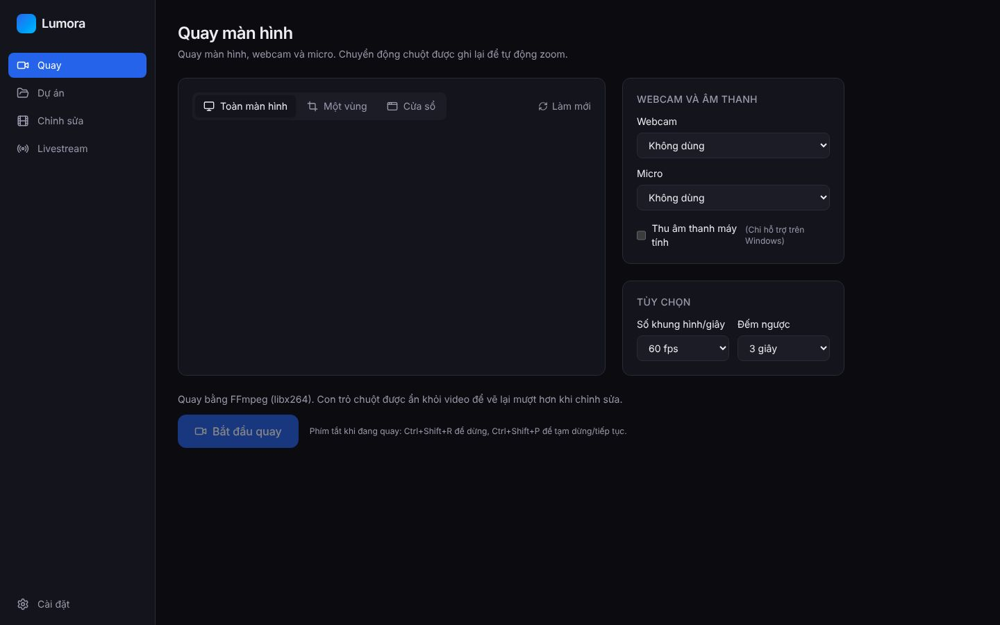
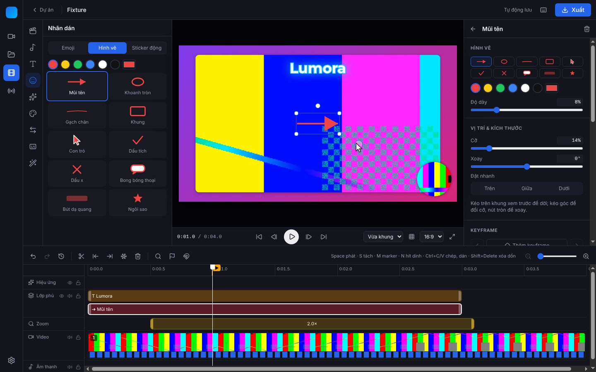
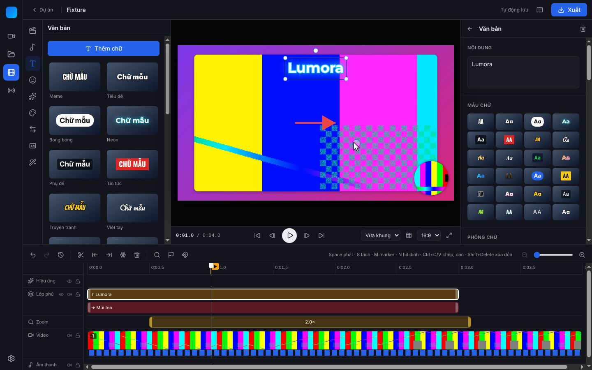
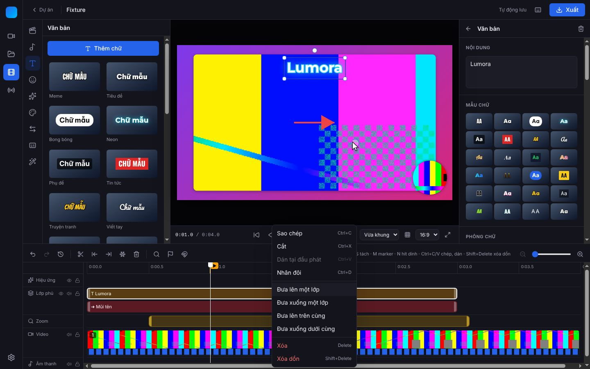
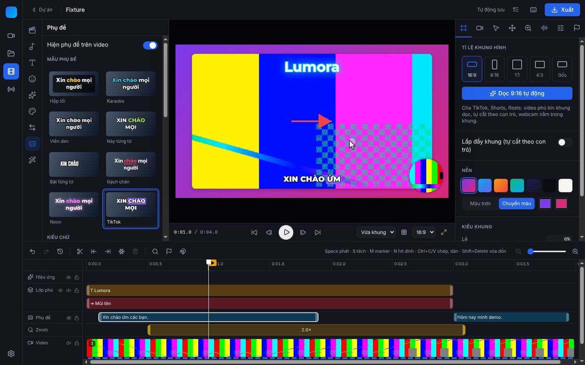
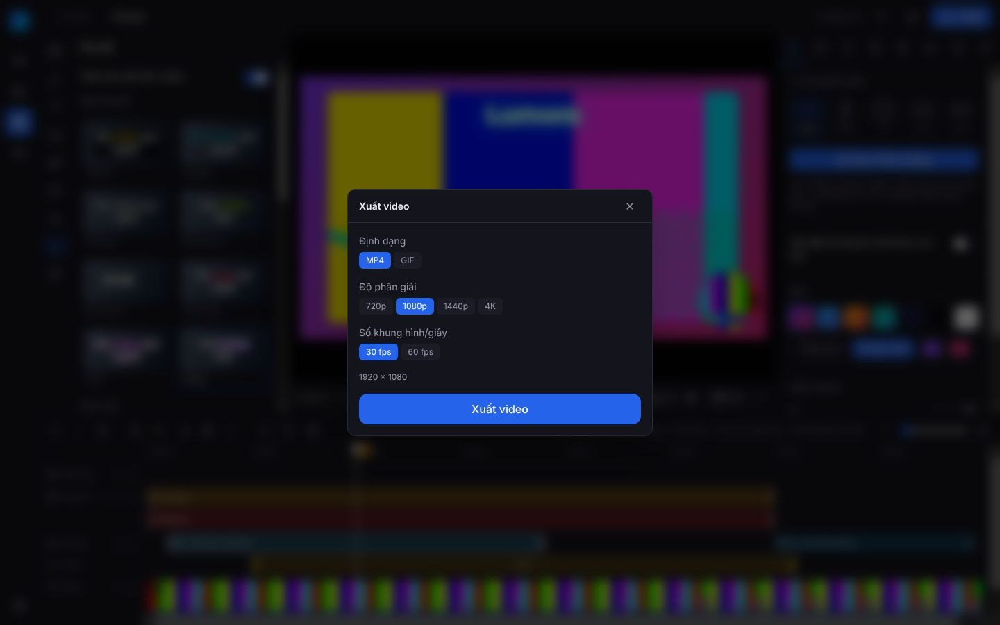

# Lumora

Phần mềm desktop cho Windows để quay màn hình, tự động zoom theo chuột, chỉnh sửa video và livestream, có tích hợp AI chạy hoàn toàn trên máy nếu muốn (phụ đề whisper.cpp, giọng đọc Piper, đạo diễn / tự biên tập Ollama) hoặc dịch vụ (ElevenLabs, Claude).
Lấy cảm hứng từ Screen Studio, FocuSee, CursorClip và StreamYard.

Kế hoạch đầy đủ nằm trong [PLAN.md](PLAN.md).

## Tình trạng

| Giai đoạn | Nội dung                                                              | Trạng thái |
| --------- | --------------------------------------------------------------------- | ---------- |
| 0         | Khung app, Cài đặt (API key, ngôn ngữ, giao diện), CI tự build `.exe` | ✅ Xong    |
| 1         | Quay màn hình, webcam, micro                                          | ✅ Xong    |
| 2         | Trình chỉnh sửa, auto-zoom                                            | ✅ Xong    |
| 3         | AI: phụ đề, tự biên tập                                               | ✅ Xong    |
| 4         | Livestream (đa nền tảng, khách mời, bình luận, phụ đề trực tiếp)      | ✅ Xong    |
| 5         | Hoàn thiện: icon, tự cập nhật, nhật ký lỗi                            | ✅ Xong    |
| 6         | Lộ trình kiểu CapCut (ROADMAP Bước 1–6), bản 1.0                      | ✅ Xong    |

## Tải bản cài về chạy thử (không cần cài gì thêm)

1. Vào tab **Actions** của repo trên GitHub và chọn lần chạy **CI** mới nhất có dấu ✅.
2. Kéo xuống mục **Artifacts** và tải **Lumora-Setup-windows** về.
3. Giải nén rồi chạy `Lumora-Setup-x.y.z.exe`.
4. Nếu Windows hiện "Windows protected your PC", bấm **More info** rồi **Run anyway**. Cảnh báo này xuất hiện vì app chưa được ký số.

## Hướng dẫn sử dụng nhanh

1. **Quay**: trang Quay → chọn Toàn màn hình / Một vùng / Cửa sổ, webcam, micro → **Bắt đầu quay** (Ctrl+Shift+R để dừng).

   

2. **Chỉnh sửa**: Dự án → chọn bản quay → **Chỉnh sửa**. Bên trái là thư viện (phương tiện, âm thanh, chữ, nhãn dán, hiệu ứng, bộ lọc, chuyển cảnh, phụ đề, AI), giữa là khung xem trước, phải là thuộc tính, dưới là timeline. Muốn chỉnh video có sẵn trên máy: Phương tiện → **Nhập video**. Lần đầu mở có hướng dẫn 5 bước; bấm **?** để xem phím tắt.

   

3. **Chữ và hình**: thư viện Văn bản có 24 mẫu; chọn lớp chữ để đổi phông, màu, viền, bóng, nền, hiệu ứng chữ, hoặc cho giọng AI đọc.

   

4. **Timeline**: kéo khối để dời (tự hít dính), kéo mép để đổi độ dài, chuột phải để sao chép / nhân đôi / xóa dồn / đưa lên lớp trên; M thêm marker.

   

5. **Phụ đề**: thư viện Phụ đề → **Tạo phụ đề** (giọng nói cục bộ whisper.cpp, hoặc key ElevenLabs) → chọn mẫu (ví dụ TikTok), dịch hoặc song ngữ (cần key Claude).

   

6. **Xuất**: nút **Xuất** → MP4 hoặc GIF, 720p–4K, 30/60 fps. Đóng hộp thoại vẫn chỉnh sửa được; tiến độ ở nút Việc đang làm.

   

Các thay đổi theo từng phiên bản: [CHANGELOG.md](CHANGELOG.md).

## Quay video

1. Mở tab **Quay** và chọn **Toàn màn hình**, **Một vùng** hoặc **Cửa sổ**.
2. Chọn webcam, micro, bật **Thu âm thanh máy tính** nếu cần, rồi bấm **Bắt đầu quay**.
3. Cửa sổ Lumora thu nhỏ lại, chỉ còn một thanh điều khiển nhỏ ở đầu màn hình. Thanh này không bị quay vào video.
4. Phím tắt: **Ctrl+Shift+R** để dừng và lưu, **Ctrl+Shift+P** để tạm dừng hoặc quay tiếp.
5. Quay xong, dự án tự mở ra để xem lại. Các dự án được lưu trong `Videos\Lumora`; bạn đổi được thư mục này trong `settings.json`.

Cách app quay:

- **Toàn màn hình và một vùng**: dùng FFmpeg (`ddagrab`, dự phòng `gdigrab`). App tự dò bộ mã hóa phần cứng theo thứ tự NVENC, AMF, QSV, cuối cùng là x264 chạy bằng CPU. **Con trỏ chuột không bị quay vào video**, để đến Giai đoạn 2 vẽ lại con trỏ mượt hơn.
- **Cửa sổ**: dùng bộ quay của Electron. Cách này không ẩn được con trỏ.
- **Chuột và bàn phím** được ghi vào `events.jsonl` để làm tự động zoom. App **không lưu ký tự bạn gõ**, chỉ ghi lại là có gõ phím và các phím tắt như Ctrl+C.
- Mỗi lần tạm dừng tạo ra một **đoạn** (segment) mới. Mỗi nguồn (màn hình, webcam, micro, âm thanh máy) là một file riêng.

## Chỉnh sửa và xuất video

Mở một dự án và bấm **Chỉnh sửa**. Bố cục giống CapCut: thanh tiêu đề chứa tên dự án và nút Xuất (nút cửa sổ kiểu Windows ở góc phải), hàng mục thư viện ngang có biểu tượng kèm nhãn, cột mục con bên trái, bảng thuộc tính tab chữ; bề mặt kính mờ, bo góc lớn; đổi màu chủ đạo, giao diện tối / sáng và **Giảm trong suốt** trong Cài đặt.

- **Bên trái — Thư viện** (cột mục có biểu tượng và nhãn như CapCut): Phương tiện · Âm thanh · Văn bản · Nhãn dán · Hiệu ứng · Bộ lọc · Chuyển cảnh · Phụ đề · AI. Bấm một mục để thêm tại đầu phát.
- **Giữa — Xem trước**: bấm vào chữ, sticker, video meme hoặc **webcam** để chọn; kéo để dời, kéo góc để đổi cỡ, kéo nút tròn để xoay. Thanh điều khiển: về đầu, lùi/tới 1 khung hình, phát/dừng, tới cuối, đổi tỉ lệ khung, toàn màn hình.
- **Bên phải — Thuộc tính**: chọn một mục thì hiện thuộc tính của mục đó; không chọn gì thì hiện cài đặt chung (Khung hình, Webcam, Con trỏ, Chuyển động, Zoom, Âm lượng).
- **Dưới — Timeline**: thanh công cụ (hoàn tác, tách, xóa trái/phải, xóa, thêm zoom), phóng to/thu nhỏ timeline (hoặc Ctrl + lăn chuột), kéo mép trên để đổi chiều cao. Các khối trùng giờ tự xếp thành nhiều hàng con.
- **Xuất** ở góc trên bên phải.

Tính năng:

- **Tự động zoom**: lần đầu mở, app gom các click chuột và đoạn gõ phím liên tục để tự tạo đoạn zoom. Khung nhìn đi theo con trỏ và chuyển vào/ra mượt. Trên timeline, kéo đoạn zoom để di chuyển, kéo mép để đổi độ dài; bấm vào đoạn zoom để chỉnh mức zoom và kiểu zoom.
- **Tất cả đoạn zoom** (tab Zoom của bảng bên phải): kéo **Mức zoom chung** rồi **Đặt … cho cả N đoạn** để mọi đoạn cùng một mức cố định; đổi **kiểu zoom cho tất cả** (theo con trỏ / cố định). Đang chọn một đoạn thì có nút **Áp dụng mức này cho tất cả**; chuột phải lên đoạn zoom cũng có các lệnh này và **Chỉnh tất cả đoạn zoom…**. Muốn zoom theo lời nói hoặc theo yêu cầu riêng thì dùng **Chỉnh zoom bằng Claude** (mục AI).
- **Con trỏ** được vẽ lại từ dữ liệu chuột, làm mượt bằng mô phỏng lò xo. Có thể phóng to con trỏ, bật hiệu ứng khi click, và tự ẩn khi chuột đứng yên.
- **Khung hình**: chọn tỉ lệ 16:9, 9:16, 1:1, 4:3 hoặc giữ tỉ lệ gốc; nền trơn hoặc chuyển màu; lề, bo góc, bóng đổ.
- **Video dọc 9:16 (TikTok, Shorts, Reels)**: bấm **Dọc 9:16 tự động**. Video màn hình phủ kín khung dọc, phần thừa được cắt và khung nhìn tự đi theo con trỏ (giống Screen Studio). Webcam là bong bóng nổi hoặc **Chia đôi khung** (dải webcam ở trên/dưới).
- **Webcam đặt tự do**: kéo bong bóng webcam tới bất kỳ đâu trên khung xem trước (gần góc / giữa cạnh thì tự hít vào), kéo góc để đổi cỡ, hoặc dùng ô vị trí 9 điểm neo. Hình dạng tròn / bo góc / vuông, viền và màu viền. **Khung mặt**: phóng to mặt và dời khung cắt để mặt nằm giữa bong bóng.
- Mọi thay đổi hiện ngay trên khung xem trước, không cần bấm phát.
- **Chuyển động**: tốc độ con trỏ, tốc độ khung nhìn đi theo con trỏ, tốc độ zoom vào/ra — kéo về "Chậm" cho chuyển động mượt kiểu điện ảnh.
- **Làm đẹp mặt** (Webcam): bấm **Làm đẹp tự động** hoặc chỉnh mịn da, làm sáng, tông ấm. Áp dụng cả khi xuất và khi livestream.
- **Timeline kiểu CapCut**: mỗi clip có dải ảnh thu nhỏ của video ở trên và dạng sóng âm thanh ở dưới — sóng là một vùng tô liền, đối xứng qua trục giữa (không phải các cột rời); đoạn âm thanh là khối màu đặc với sóng trắng.
- **Phương tiện** (Thư viện → Phương tiện): **Nhập video** chọn video trên máy để chỉnh sửa như CapCut (nối vào hàng Video làm clip chính); **Nhập ảnh** thêm ảnh / GIF (hoặc video ngắn làm lớp phủ) vào **Thư viện của tôi** dùng lại ở mọi dự án; **Video / Ảnh** tìm video, ảnh miễn phí trên **Pixabay** ngay trong app (rê chuột là phát thử, bấm để tải về thư viện và thêm vào video; cần key miễn phí lấy ở pixabay.com/api/docs sau khi đăng ký, nhập trong **Cài đặt → API key**). Kho meme Tenor đã bị Google khai tử ngày 30/6/2026 nên không còn trong app; meme đã tải trước đó vẫn nằm trong thư viện của bạn.
- **Âm thanh meme**: 10 hiệu ứng meme tự tổng hợp (Bùm kiểu Vine, Còi thua, Rít đĩa, Còi hơi, Trống dồn, Ting tiền, Dế kêu, Boing, Vút lên, Tim đập) và **giọng đọc AI** (Piper trên máy hoặc ElevenLabs): chọn giọng, bấm câu meme có sẵn ("Bruh", "Ối dồi ôi", "Hết cứu"…) hoặc gõ câu bất kỳ để thêm vào timeline. Câu đã đọc được lưu đệm, đọc lại không tốn credit.
- **Lọc tạp âm & giọng nói** (Cài đặt video → Âm lượng cho micro / âm thanh máy, hoặc chọn một đoạn âm thanh): **Lọc tạp âm** Nhẹ / Vừa (AI RNNoise, chạy offline, cho kết quả như nhau trên mọi máy) / Mạnh; **Tăng cường giọng nói** (bỏ ù, khử xì, nén cho giọng rõ đều); **Chuẩn hóa âm lượng** về -16 LUFS; **hiệu ứng giọng** Sóc chuột, Trầm, Robot, Vang, Radio, Loa; chỉnh **cao độ** ±12 bán cung. Xử lý chạy nền, xong thì khung xem trước tự phát bản đã xử lý; giữ nút **Gốc** để nghe lại bản gốc. Video xuất dùng đúng bản đã xử lý.
- **Lồng tiếng** (Thư viện → Âm thanh → Lồng tiếng): chọn micro, xem mức âm, bấm ghi (đếm ngược 3 giây, tùy chọn tắt tiếng bản gốc); video phát từ đầu phát trong lúc ghi, dừng lại là bản ghi nằm đúng chỗ trên hàng Âm thanh (màu cam).
- **Tách âm thanh** của video meme ra thành đoạn riêng để cắt / chỉnh / thêm hiệu ứng như nhạc. Nhạc nền hiện **vạch nhịp** (beat) trên timeline để cắt theo nhạc.
- **Clip video**: bảng thuộc tính chia tab **Video · Điều chỉnh · Âm thanh · Tốc độ** như CapCut — tắt tiếng hoặc chỉnh âm lượng micro / âm thanh máy riêng từng clip, tốc độ 0.25–8×.
- **Bộ lọc màu** (Thư viện → Bộ lọc): 11 mẫu (Điện ảnh, Cổ điển, Lạnh, Ấm, Đen trắng, Phai màu, Rực rỡ, Noir, Pastel, Xanh cam, Hoàng hôn) với độ mạnh. Không chọn gì thì áp dụng cho cả video; chọn một clip thì chỉ clip đó (nút **Dùng chung** để bỏ); chọn ảnh / video meme thì cho riêng lớp đó.
- **Điều chỉnh** (tab Điều chỉnh ở Cài đặt video hoặc của clip / ảnh): phơi sáng, độ sáng, tương phản, bão hòa, nhiệt độ màu, sắc độ, vùng sáng, vùng tối, độ nét, viền tối, hạt nhiễu.
- **Cắt · Lật · Xoay clip** (tab Video của clip): lật ngang / dọc, xoay 90°, cắt từng cạnh — khung hình tự theo tỉ lệ video sau khi xoay / cắt; con trỏ, zoom và vùng nhìn đi đúng theo.
- **Đóng băng khung hình** (nút ❄ trên thanh công cụ timeline): giữ khung đang xem 2 giây (chỉnh được 0.1–20 giây), không có tiếng, rồi video chạy tiếp đúng chỗ.
- **Đường cong tốc độ** (tab Tốc độ của clip → Đường cong): 6 mẫu như CapCut (Dựng nhanh, Khoảnh khắc, Đạn bay, Nhảy cắt, Lướt vào, Lướt ra) hoặc kéo điểm trên đồ thị (0.1×–10×); tiếng khi xuất đổi tốc độ theo từng đoạn ngắn.
- **Phát ngược** clip (tab Video của clip): cả hình và tiếng chạy từ cuối về đầu; bản đảo ngược được tạo ở nền (clip trong một đoạn quay, tối đa 2 phút). **Độ mờ** clip để thấy nền phía sau.
- **Phông nền AI cho webcam** (Cài đặt video → Webcam → Phông nền (AI)): **Xóa** phông (thấy video màn hình phía sau người), **Làm mờ** phông hoặc thay bằng **Màu**; chỉnh độ mềm viền. Ảnh / video meme có nút **Xóa phông AI** để tách người không cần phông xanh. AI (MediaPipe) chạy ngay trên máy, không gửi video đi đâu; máy không có GPU vẫn chạy được (WebGL phần mềm).
- **Che vùng riêng tư** (Thư viện → Hiệu ứng → Che vùng riêng tư): vùng **Làm mờ** hoặc **Khảm ô (mosaic)** như CapCut để giấu mật khẩu, email, tên người. Kéo trên khung xem trước để đặt, kéo góc để đổi cả chiều rộng lẫn chiều cao, chỉnh độ mạnh và tỉ lệ; là một lớp phủ nên có keyframe (vùng che đi theo cửa sổ), cắt / dời trên hàng Lớp phủ. Video xuất che đúng như xem trước.
- **Tự giảm nhạc khi có lời** (Cài đặt video → Âm lượng → Nhạc nền): bật là nhạc nền tự nhỏ lại khi micro có tiếng hoặc ở các đoạn lồng tiếng / kịch bản AI, to lại khi im lặng (audio ducking như CapCut / Descript / Camtasia). Mức nhạc khi có lời chỉnh được (mặc định 30 %); khoảng có lời tính từ dạng sóng bản quay nên chạy offline, xem trước và video xuất giảm giống nhau.
- **Hiện phím tắt đã bấm** (Cài đặt video → Con trỏ): phím tắt bấm trong lúc quay (Ctrl+C, Alt+Tab, Win+Shift+S…) hiện thành viên thuốc dưới khung hình rồi mờ dần, phím bấm liên tiếp xếp cạnh nhau — như Screen Studio / Camtasia. Bản quay chỉ lưu phím tắt (có Ctrl / Alt / Win), không lưu chữ gõ thường nên không lộ mật khẩu.
- **Chụp khung hình** (nút ảnh cạnh Toàn màn hình dưới khung xem trước): lưu khung đang xem (kể cả chữ, nhãn dán, vùng che) thành PNG trong thư mục `exports` của dự án, có nút mở thư mục — như "Snapshot" của CapCut, tiện làm ảnh bìa.
- **Lớp phủ nâng cao** (chọn chữ / nhãn dán / ảnh / video meme): **Hoạt ảnh** vào (12 kiểu: bật ra, mờ dần, trượt 4 hướng, phóng to, xoay, nảy, lật, nhòe, đánh chữ), ra (8 kiểu) và lặp (nhún, rung, nhịp, đung đưa, lơ lửng, nhấp nháy) với thời lượng riêng; **Keyframe** vị trí / cỡ / góc / độ mờ (bấm ◇ tại đầu phát, kéo lớp trên khung xem trước hoặc kéo thanh trượt là tự ghi keyframe; chọn kiểu chuyển Đều / Nhanh dần / Chậm dần / Mượt; hình thoi trên timeline để nhảy tới); **Độ mờ**, **chế độ hòa trộn** (Screen, Multiply, Overlay, Lighten, Darken, Difference, Add), **lật**; **Mặt nạ** cho ảnh / video (tròn, chữ nhật, trái tim, ngôi sao, tuyến tính, gương; viền mềm, đảo ngược).
- **Ô số cạnh mọi thanh trượt**: bấm vào để gõ số (Enter áp dụng, mũi tên lên / xuống tăng giảm, Shift để bước lớn), nút ↺ để về mặc định. Mọi nút chỉ có biểu tượng đều có chú thích khi rê chuột (kèm phím tắt).
- **Lớp phủ video / ảnh** (Thư viện → Phương tiện → Của tôi): **kéo thả** video ngắn (MP4, MOV, WEBM, MKV…) hoặc ảnh / GIF vào thư viện một lần, dùng lại ở mọi dự án. Video được chuẩn hóa sang MP4 (tối đa 1280px, 2 phút). Bấm để thêm vào timeline tại đầu phát — video **có tiếng** (chỉnh âm lượng), cắt đầu/cuối trên timeline, **Phủ kín khung** hoặc **Vừa khung**, và **Xóa phông** (phông xanh lá / xanh dương / đen / trắng, chỉnh độ mạnh) để chỉ giữ lại nhân vật. Lumora không kèm sẵn meme có bản quyền — hãy dùng video bạn có quyền sử dụng.
- **Nhạc nền & hiệu ứng âm thanh** (Thư viện → Âm thanh): **Thêm nhạc từ máy** (MP3, WAV, M4A, OGG, FLAC…) hoặc chọn hiệu ứng có sẵn (Vút, Bụp, Ting, Bùm, Ta-da, Vỗ tay, Buồn wah-wah, Bíp che từ…). Kéo để dời, kéo mép để cắt; chỉnh âm lượng, tăng dần/nhỏ dần, lặp lại. Hiệu ứng âm thanh do app tự tổng hợp nên không vướng bản quyền.
- **Chuyển cảnh** giữa hai clip: bấm nút ◆ ở chỗ nối trên timeline (hoặc Thư viện → Chuyển cảnh) → 21 kiểu chia 4 nhóm: **Cơ bản** (Mờ qua đen / trắng, Lóe sáng, Lọt sáng), **Chuyển động** (Phóng to, Thu nhỏ, Lia máy, Xoay, Lướt trái / phải / lên / xuống, Rung lắc), **Hình khối** (Kéo rèm, Vòng tròn, Rèm sáo, Ép dẹt, Lật thẻ), **Cách điệu** (Làm nhòe, Glitch, Khảm ô); chỉnh thời gian; áp dụng cho tất cả chỗ nối.
- **Hiệu ứng hình** (Thư viện → Hiệu ứng): 27 kiểu chia 5 nhóm — **Chuyển động** (Rung lắc, Nhún theo nhịp, Phóng nhấn, Nhảy nhún, Gương đối xứng), **Glitch & retro** (Glitch, VHS cổ, Tách màu RGB, Khảm ô, Hạt phim), **Màu sắc** (Đen trắng, Cổ điển, Đảo màu, Hai tông màu, Tông ấm, Tông lạnh), **Ánh sáng & khung** (Lóe theo nhịp, Nhấp nháy nhanh, Tỏa sáng, Lọt sáng, Viền tối, Đèn rọi, Dải điện ảnh, Làm mờ), **Hạt bay** (Pháo giấy, Lấp lánh, Tuyết rơi) — rê để xem thử, bấm để thêm tại đầu phát, kéo trên hàng Hiệu ứng để dời / đổi độ dài, chỉnh độ mạnh; xuất giống hệt xem trước.
- **Văn bản** (Thư viện → Văn bản): **24 mẫu chữ** có xem trước (Meme, Tiêu đề, Bong bóng, Neon, Phụ đề, Tin tức, Truyện tranh, Viết tay, Retro, Hoàng hôn, Vàng kim, Karaoke, TikTok…) và **10 phông có dấu tiếng Việt** đi kèm (Be Vietnam Pro, Inter, Montserrat, Oswald, Anton, Bangers, Lobster, Pacifico, Roboto Mono, Playfair Display — giấy phép OFL, dùng offline). Bảng chữ: đậm / nghiêng / chữ in hoa / căn lề, màu hoặc **chuyển màu**, **viền**, **bóng đổ**, **nền chữ** bo góc, giãn dòng / giãn chữ, **hiệu ứng chữ** (Đánh máy, Bật từng từ, Lượn sóng, Nhiễu, Trượt từng từ). **Đọc chữ này**: giọng AI đọc nội dung lớp chữ, đặt đúng lúc chữ xuất hiện.
- **Nhãn dán**: 30 emoji và **hình vẽ sẵn** cho video hướng dẫn (mũi tên, khoanh tròn, gạch chân, khung, con trỏ, dấu tích, dấu x, bong bóng thoại, bút dạ quang, ngôi sao) đổi màu và độ dày nét được.
- **AI cục bộ, miễn phí (Ollama)**: Cài đặt → AI cục bộ → bấm **Cài Ollama** (app tải bộ cài chính thức và mở), **Kiểm tra kết nối**, rồi **Tải model** (ví dụ qwen2.5:7b, có thanh tiến độ) và bật. Khi bật, Đạo diễn AI, cắt từ thừa / câu lặp, tóm tắt và dịch chạy hoàn toàn trên máy, không cần key Claude. Những phần AI khác vốn đã chạy trên máy: tự zoom theo chuột, cắt khoảng lặng theo dạng sóng, lọc tạp âm RNNoise, xóa phông MediaPipe, từ đệm theo danh sách. Phụ đề và giọng đọc AI chạy trên máy bằng **Giọng nói cục bộ** (mục dưới).
- **Thiết lập AI trên máy một chạm** (Cài đặt → AI trên máy): danh sách kiểm tra 6 bước và nút **Thiết lập tất cả** tự cài Ollama + model, whisper.cpp + model, Piper + giọng rồi bật; huy hiệu trạng thái AI trên thanh tiêu đề và thanh trạng thái đầu bảng AI cho biết đang dùng engine nào, sẵn sàng chưa và việc nào đang chạy.
- **Giọng nói cục bộ, miễn phí (whisper.cpp + Piper)**: Cài đặt → AI trên máy → Nâng cao → **Cài whisper.cpp** (~4 MB), **Tải model** (khuyên dùng `large-v3-turbo-q5_0` ~570 MB cho tiếng Việt; `small` nhẹ hơn nhưng kém hơn), **Cài Piper** (~22 MB), **Tải giọng** (tiếng Việt `vi_VN-vais1000-medium` ~63 MB, có cả giọng tiếng Anh) rồi bật. Khi bật, phụ đề (nhận dạng từng từ), cắt khoảng lặng / từ thừa theo lời thoại, giọng đọc meme / kịch bản / "Đọc chữ này" chạy hoàn toàn trên máy, không cần key ElevenLabs; tắt thì quay lại ElevenLabs. Model chạy trên CPU: video 10 phút mất chừng 1–3 phút với model turbo trên máy phổ thông.
- **Tự dựng một nút** (Thư viện → AI → Tự dựng một nút): quay xong, chọn định dạng (hoặc để app tự chọn) rồi bấm **Tự dựng ngay**: AI lập kế hoạch dựng chuyên nghiệp trong một lần gọi (phần lời nhắc cố định được cache nên rất tiết kiệm token), app làm rồi tự rà soát theo sổ tay. Tuỳ chọn **tự tìm nhạc nền miễn phí bản quyền** trên Jamendo (key Client ID miễn phí ở devportal.jamendo.com; chỉ lấy nhạc Creative Commons cho phép dùng thương mại, app đưa sẵn dòng ghi nguồn để dán vào mô tả), **chèn tư liệu** video stock Pixabay ở đoạn nói chung chung, và **tách thêm 2–3 video ngắn hay nhất** (dọc, phụ đề TikTok, hook) thành dự án riêng.
- **Đạo diễn AI** (Thư viện → AI → Đạo diễn AI): gõ một câu, ví dụ "làm thành video TikTok hoàn chỉnh: cắt lặng, phụ đề kiểu TikTok, nhạc lofi nhỏ, hiệu ứng rung ở chỗ cắt, xuất 9:16 1080p"; AI (Ollama trên máy, Claude, hoặc từ khóa khi không có AI) viết lại thành kế hoạch, hỏi lại tối đa hai câu khi thiếu thông tin, rồi tự làm hết trong một bước hoàn tác và tự xuất nếu bạn yêu cầu. Lịch sử trò chuyện lưu theo dự án; "từ nay luôn…" thành quy tắc lâu dài; app học thói quen (mẫu phụ đề, bộ lọc, khung hình, nhạc…) từ cách bạn chỉnh. Bật **Hỏi lại trước khi làm** để duyệt kế hoạch trước.
- **Xem thử trước khi thêm** (như CapCut): rê chuột lên một hiệu ứng, bộ lọc, chuyển cảnh, meme / GIF / video trong kho, nhãn dán, mẫu chữ hoặc mục kho online là khung xem trước phát thử một đoạn ngắn (lặp lại) mà chưa thêm gì vào dự án; bỏ chuột ra là trở lại chỗ cũ, bấm mới thêm thật. Nhạc trong kho có nút ▶ **Nghe thử**.
- **Kéo giãn khung**: kéo vạch giữa thư viện / khung xem trước / bảng thuộc tính và vạch trên timeline để đổi cỡ như CapCut (nhớ cho lần sau, bấm đúp để về mặc định).
- **Chia nhỏ video thành video ngắn** (Thư viện → AI): theo chương AI hoặc mỗi 60 / 90 / 120 giây; mỗi đoạn thành một dự án riêng ở trang Dự án (khung dọc 9:16 tuỳ chọn) để xuất cho TikTok, Shorts, Reels.
- **Nâng cao chất lượng (HD)** trong hộp thoại Xuất: giảm nhiễu và làm nét khi mã hóa.
- **Nhạc nền từ Thư viện âm thanh YouTube** (Thư viện → Âm thanh → **YouTube**): bấm **Mở Thư viện âm thanh YouTube** (YouTube Studio, nhạc miễn phí bản quyền; thư viện này không có API công khai nên tải bằng trình duyệt), tải bài muốn dùng; bài vừa tải tự hiện trong app, bấm **Thêm** để đưa vào **kho nhạc của tôi** và đặt làm nhạc nền tại đầu phát. Kho nhạc dùng lại ở mọi dự án, nhận cả file trên máy (nút Thêm file hoặc kéo thả), tìm theo tên. Một số bài yêu cầu ghi công tác giả trong mô tả video.
- **AI tự biên tập** (Thư viện → AI → **AI tự biên tập**): chọn các bước (cắt khoảng lặng, bỏ từ thừa / câu lặp, tự zoom theo chuột, thêm phụ đề, làm sạch âm thanh, tiêu đề mở đầu) rồi bấm một lần; app báo kết quả từng bước (xong / bỏ qua kèm lý do). Không có key ElevenLabs vẫn cắt được khoảng lặng theo dạng sóng; không có key Claude vẫn bỏ được từ đệm theo danh sách có sẵn. Một lần Hoàn tác đưa về bản trước.
- **Kịch bản giọng AI** (Thư viện → Âm thanh → Kịch bản): dán kịch bản, mỗi dòng một câu; giọng AI đọc lần lượt thành các đoạn lồng tiếng nối tiếp từ đầu phát, tùy chọn tự thêm phụ đề cho từng câu. Một lần Hoàn tác bỏ cả kịch bản.
- **Timeline chuyên nghiệp**: **chọn nhiều** (Ctrl/Shift+click, kéo khung chọn trên chỗ trống, Ctrl+A); **sao chép / cắt / dán / nhân đôi** lớp phủ, hiệu ứng, âm thanh (Ctrl+C / X / V / D, dán tại đầu phát giữ nguyên khoảng cách); **xóa dồn** (Shift+Delete) để các mục phía sau tự dồn lại; **hít dính** khi kéo (vào đầu phát, chỗ nối clip, mép khối khác, marker; phím N bật / tắt, giữ Alt để tạm tắt); **menu chuột phải** trên clip, lớp phủ, âm thanh và chỗ trống (tách, đóng băng, phát ngược, tắt tiếng, đưa lên / xuống lớp, tách âm thanh…).
- **Đầu hàng timeline**: **ẩn** (hàng Hiệu ứng, Lớp phủ, Phụ đề), **tắt tiếng** (Video, Âm thanh, Lớp phủ) và **khóa** từng hàng. Hàng ẩn / tắt tiếng không có trong cả xem trước lẫn video xuất.
- **Nhập video từ máy làm clip chính** (Thư viện → Phương tiện → Nhập video, hoặc kéo file video từ Explorer thả vào timeline): video được chuẩn hóa sang MP4 (tối đa 1080p) và nối vào cuối như một clip, có tiếng, cắt / tách / đổi tốc độ / lọc màu như bản quay. **Ghép bản quay khác** vào cuối (giữ đường con trỏ khi cùng vùng màn hình).
- **Kéo thả từ thư viện**: kéo thẻ meme, hiệu ứng, mẫu chữ, emoji, hình vẽ, hiệu ứng âm thanh vào timeline để thêm đúng chỗ thả (có vạch báo vị trí). Rê chuột trên clip video để xem ảnh khung hình tại đó.
- **Tách âm thanh clip chính** (menu chuột phải trên clip, hoặc tab Âm thanh của clip): micro và âm thanh máy thành các đoạn riêng trên hàng Âm thanh, clip tự tắt tiếng.
- **Marker** (phím M hoặc nút cờ): cờ màu trên thước, kéo để dời, bấm đúp để đổi tên, Shift+M / Ctrl+M nhảy marker trước / sau. Cài đặt video → Marker: danh sách, đổi màu, và **chương YouTube** (sao chép hoặc lưu `.txt`).
- **Việc chạy nền**: xuất video, nhập video, ghép bản quay, đọc kịch bản AI, tạo phụ đề hiện ở nút **Việc đang làm** trên đầu trình chỉnh sửa (tiến độ, hủy). Xuất dùng bản chụp lúc bấm nên đóng hộp thoại xuất là chỉnh sửa tiếp được; xong có thông báo kèm nút mở thư mục.
- **Lịch sử chỉnh sửa** (nút đồng hồ trên thanh công cụ timeline): danh sách từng bước ("Thêm lớp phủ", "Sửa webcam"…), bấm để quay về hoặc tới bước bất kỳ; chú thích nút Hoàn tác / Làm lại ghi rõ bước sẽ hoàn tác.
- **Đường gióng xem trước**: chia ba, hoặc vùng an toàn TikTok / Shorts (vùng bị chữ và nút của ứng dụng che). Khung xem trước tự hạ xuống 540p khi máy chậm (nhãn "Xem trước nhẹ"); chỉnh trong Cài đặt → Trình chỉnh sửa.
- **An toàn dữ liệu**: bản chỉnh sửa tự lưu liên tục; nếu app tắt đột ngột (mất điện, treo máy), lần mở sau báo đã khôi phục bản tự lưu. Lỗi giao diện được ghi vào nhật ký để báo lỗi. **Tỉ lệ xem trước** Vừa khung hoặc 25–200 %.
- **Hướng dẫn lần đầu** 5 bước khi mở trình chỉnh sửa (xem lại trong Cài đặt), bảng **phím tắt** (phím ? hoặc nút bàn phím).
- **Dự án**: đổi tên, nhân đôi (không chép video đã xuất); **mẫu cho bản quay mới** trong Cài đặt: hướng dẫn 16:9, TikTok / Shorts 9:16 (phủ kín khung, phụ đề kiểu TikTok), vuông 1:1.
- **Phím tắt**: Space phát/dừng · S tách · **A xóa phần bên trái đầu phát** · **D xóa phần bên phải đầu phát** · Delete xóa mục đang chọn · Shift+Delete xóa dồn · Ctrl+C / X / V / D / A · M marker · N hít dính · Esc bỏ chọn · Home/End về đầu/cuối · ←/→ lùi/tới 1 giây · Ctrl+Z / Ctrl+Y.
- **Dạng sóng âm thanh** hiện ngay trong từng clip video trên timeline (micro + âm thanh máy), nên dễ thấy chỗ đang nói và chỗ im lặng để cắt.
- **Timeline**: tách (phím S), xóa (Delete), đổi tốc độ từng đoạn, hoàn tác/làm lại (Ctrl+Z / Ctrl+Y). Bản chỉnh sửa được tự lưu vào `edit.json`.
- **Xuất**: MP4 (H.264 + AAC) hoặc GIF; 720p, 1080p, 1440p hoặc 4K; 30 hoặc 60 fps. File được lưu trong thư mục `exports` của dự án.

Phần xem trước và phần xuất dùng chung một hàm vẽ, nên video xuất ra giống hệt những gì bạn thấy khi chỉnh. Khi xuất, mediabunny/WebCodecs giải mã chính xác từng khung hình và mã hóa bằng card đồ họa nếu có. Sau đó FFmpeg cắt, đổi tốc độ và trộn âm thanh micro/máy theo đúng các đoạn đã cắt.

## AI

Chạy hoàn toàn trên máy (miễn phí): bật **AI cục bộ** (Ollama) và **Giọng nói cục bộ** (whisper.cpp + Piper) trong **Cài đặt**. Hoặc nhập API key **ElevenLabs** và **Claude** để dùng dịch vụ. Trong trình chỉnh sửa:

- **Phụ đề** (whisper.cpp trên máy, hoặc ElevenLabs Scribe v2): nhận dạng tiếng Việt, tiếng Anh hoặc tự nhận diện ngôn ngữ, có thời gian từng từ.
  - **8 mẫu phụ đề** có xem trước: Hộp tối, Karaoke (tô dần các từ đã nói), Viền đen, Nảy từng từ, Bật từng từ, Gạch chân, Neon, TikTok (chữ in hoa đậm, khối màu sau từ đang nói). Chỉnh phông (10 phông đi kèm), màu chữ, màu nhấn, chữ in hoa, số từ hiện mỗi lần (1–4 hoặc cả dòng), vị trí trên / giữa / dưới hoặc kéo độ cao, cỡ chữ; tô sáng từ đang nói hoặc hiện cả dòng.
  - Sửa nội dung từng dòng; **tách** dòng làm đôi hoặc **gộp** với dòng sau.
  - **Tìm và thay thế** trong mọi dòng (và bản dịch): phân biệt hoa thường, cả từ; các dòng khớp được viền sáng. Thay trong từng từ nên vẫn tô sáng từng từ được.
  - **Sửa phụ đề bằng Claude**: **Sửa chính tả & dấu câu** một nút, hoặc gõ yêu cầu (viết hoa tên sản phẩm, bỏ từ đệm, đổi một từ ở mọi chỗ, đổi giọng văn…). Thời gian giữ nguyên, chỉ dòng đổi mới được đánh dấu đã sửa.
  - Hàng **Phụ đề** trên timeline: mỗi dòng một khối, bấm để nhảy tới, kéo để dời, kéo mép để chỉnh thời gian.
  - **Dịch** bằng Claude sang 10 ngôn ngữ (Việt, Anh, Nhật, Hàn, Trung, Thái, Indonesia, Pháp, Tây Ban Nha, Đức): thay nội dung bằng bản dịch, hoặc **phụ đề song ngữ** (dòng dịch nhỏ hơn hiện bên dưới, sửa riêng được).
  - Lưu ra SRT/VTT hoặc in thẳng vào video khi xuất.
- **Giọng đọc AI** (Piper trên máy, hoặc ElevenLabs): chỉnh **tốc độ đọc** (0.7–1.2×) và **độ ổn định** của giọng, dùng chung cho câu meme, kịch bản và "Đọc chữ này".
- **AI** (Claude):
  - Tìm từ đệm, câu nói lặp và khoảng lặng dài. Bạn duyệt danh sách rồi mới áp dụng.
  - Chỉnh video bằng văn bản: chọn các từ muốn bỏ, phần video tương ứng sẽ bị cắt.
  - **Chỉnh zoom bằng Claude**: mô tả cách muốn zoom (đặt mọi zoom 2.5×, bỏ zoom ngắn hơn 2 giây, zoom lúc nói tới phần cài đặt…) hoặc chọn gợi ý sẵn (zoom theo lời nói, gọn hơn, nhẹ hơn). Claude lập lại danh sách zoom từ các đoạn hiện có, các lần click chuột và lời nói (nếu đã có phụ đề); bạn xem trước rồi mới áp dụng. Kết quả luôn được kẹp trong giới hạn (1.2–4×, không chồng nhau).
  - Tạo 3 gợi ý tiêu đề, mô tả, hashtag và chương YouTube. Thời gian các chương được tính theo video đã cắt.

Mọi lệnh gọi Claude dùng model `claude-opus-5-5` kèm structured outputs (kết quả JSON đúng schema). Các lệnh này cũng bật `fallbacks: "default"`: khi bộ lọc an toàn từ chối một yêu cầu, máy chủ Anthropic tự chạy lại yêu cầu đó trên một model dự phòng phù hợp.

## Livestream

Mở tab **Livestream**. Studio vẽ cảnh 30 khung hình/giây (720p hoặc 1080p), FFmpeg mã hóa một lần rồi phát **cùng lúc** tới mọi kênh đã bật.

- **Kênh phát**: YouTube, Facebook, TikTok, Twitch hoặc RTMP tùy chỉnh. Stream key được mã hóa như API key (`live-secrets.json`), không nằm trong file cấu hình và không hiện lại trên giao diện. Mỗi kênh hiện trạng thái riêng (đang kết nối, đang phát, lỗi); một kênh lỗi không làm dừng các kênh khác.
- **Studio**: bố cục một người, lưới, màn hình kèm người, PiP; chia sẻ màn hình hoặc cửa sổ; banner; tên hiển thị trên từng người.
- **Khách mời**: bấm **Mở phòng khách mời**, gửi link cho khách. Khách mở bằng trình duyệt, không cần cài gì, vào **hậu trường** trước, rồi host đưa lên hoặc xuống sóng hay mời ra. Hình và tiếng đi thẳng giữa hai máy qua WebRTC. Khách nghe mọi người trừ chính mình (mix-minus) và xem được hình chương trình.
  - Khách cùng mạng nội bộ dùng link IP (cổng 47800).
  - Khách ở xa: tạo một đường hầm (ví dụ `cloudflared tunnel --url http://localhost:47800`) rồi dán địa chỉ công khai vào **Cài đặt → Địa chỉ công khai**.
- **Bình luận**: đọc chat YouTube (API key YouTube Data v3 + ID video) và bình luận Facebook (Page access token + ID video). Bấm **Hiện lên sóng** để đưa một bình luận lên khung hình.
- **Phụ đề trực tiếp**: cứ 5 giây, micro được gửi tới ElevenLabs và chữ hiện ở đầu khung hình.
- **Ghi lại trong máy** (bật sẵn): kết thúc buổi live, bản ghi `live.mkv` thành một dự án. Bạn mở dự án đó để chỉnh sửa, làm phụ đề và tạo chương bằng AI như video quay thường.

Nếu FFmpeg dừng giữa chừng (mất mạng, sai key) hoặc mọi kênh đều lỗi mà không ghi trong máy, buổi phát tự kết thúc và app báo lỗi.

## Chia sẻ dự án để người khác cùng chỉnh sửa

1. Mở dự án ở trang **Dự án** → **Chia sẻ** → **Gói đầy đủ**: tạo một file `.lumorapack` (video + bản chỉnh sửa). Gửi file qua Google Drive, Zalo, USB…
2. Người nhận bấm **Nhập dự án được chia sẻ** ở trang **Dự án**, rồi mở ra chỉnh sửa trên máy họ.
3. Gửi qua lại sau đó chỉ cần **Chỉ bản chỉnh sửa** (vài KB, không kèm video). Nhập gói này thì dự án được cập nhật theo bản chỉnh sửa mới; bản cũ được sao lưu (`edit.backup-….json`) trong thư mục dự án.

Màu chủ đạo của app đổi được trong **Cài đặt** (mặc định xanh dương).

## Cập nhật và nhật ký lỗi

- **Tự cập nhật**: bản đã cài tự kiểm tra GitHub Releases khoảng 10 giây sau khi mở và cứ 4 giờ một lần, rồi tải bản mới ở nền. Tải xong, một thanh báo hiện ở đầu app: bấm **Khởi động lại để cập nhật**, hoặc bỏ qua thì bản mới tự cài khi bạn thoát app. Kiểm tra bằng tay ở **Cài đặt → Thông tin**.
- **Nhật ký lỗi**: `%APPDATA%\Lumora\logs\main.log` (tối đa 5 MB, giữ thêm một bản cũ `main.old.log`). Bấm **Mở thư mục nhật ký lỗi** trong **Cài đặt → Thông tin**. API key, token và stream key được che trước khi ghi.

## Phát hành bản mới

1. Tăng `version` trong `apps/desktop/package.json` (ví dụ `0.2.0`) rồi commit.
2. Vào tab **Actions** → **Release** → **Run workflow** (workflow tự tạo tag `v0.2.0` sau khi test qua), hoặc tự push tag: `git tag v0.2.0 && git push origin v0.2.0`.
3. Workflow **Release** chạy toàn bộ test, build bộ cài và đăng lên **GitHub Releases**. Các máy đã cài sẽ tự nhận bản mới.

## Chạy từ mã nguồn

Cần cài: [Node.js 22 LTS](https://nodejs.org), [Git](https://git-scm.com) và pnpm (`npm install -g pnpm`).

```bash
pnpm install       # cài thư viện
pnpm dev           # mở app ở chế độ phát triển (tự tải lại khi sửa code)
pnpm package:win   # tạo bộ cài .exe trong apps/desktop/release/
python3 apps/desktop/scripts/make-icon.py   # vẽ lại icon (cần Pillow) nếu muốn đổi
```

## Kiểm thử tự động

```bash
pnpm check         # format + lint + typecheck + unit test + test giao diện
pnpm test:e2e      # build rồi mở app Electron thật và bấm thử bằng Playwright
```

Mỗi lần push, GitHub Actions chạy toàn bộ test trên Windows rồi mới build file `.exe`.

| Loại test                                             | Công cụ                  | Vị trí                                    |
| ----------------------------------------------------- | ------------------------ | ----------------------------------------- |
| Logic thuần (settings, API key)                       | Vitest                   | `packages/core/src/*.test.ts`             |
| Main process (lưu trữ, mã hóa key, IPC, kiểm tra key) | Vitest                   | `apps/desktop/src/main/*.test.ts`         |
| Giao diện React                                       | Vitest + Testing Library | `apps/desktop/src/renderer/**/*.test.tsx` |
| End-to-end (app Electron thật)                        | Playwright               | `apps/desktop/e2e/`                       |

Test E2E của livestream dùng FFmpeg làm máy chủ RTMP thật, mở một trình duyệt Chromium làm khách mời (webcam và micro giả) và dựng máy chủ giả lập YouTube và ElevenLabs.

## Cấu trúc

```
apps/desktop/          Ứng dụng Electron
  src/main/            Main process: cửa sổ, lưu settings, lưu API key đã mã hóa, IPC
  src/preload/         Cầu nối an toàn giữa main process và giao diện (window.lumora)
  src/renderer/        Giao diện React + Tailwind
  src/shared/          Kiểu dữ liệu dùng chung (kênh IPC)
  e2e/                 Test E2E bằng Playwright
  src/main/ffmpeg/     Dò phần cứng, tạo lệnh FFmpeg, chạy và dừng FFmpeg
  src/main/recording/  Phiên quay, bộ điều phối, ghi chuột/bàn phím, lập kế hoạch quay
  src/main/projects/   Đọc danh sách dự án, giao thức lumora-media:// (hỗ trợ tua video)
  src/main/export/     Ghi file xuất, trộn âm thanh, tạo GIF
  src/main/ai/         whisper.cpp + Piper / ElevenLabs (phụ đề, giọng đọc), Ollama / Claude (đạo diễn, cắt, tiêu đề, chương, dịch, sửa phụ đề, chỉnh zoom)
  src/main/logger.ts   Nhật ký lỗi (che thông tin bí mật)
  src/main/updater.ts  Tự cập nhật từ GitHub Releases
  src/main/live/       Phát RTMP, máy chủ báo hiệu + trang khách mời, bình luận, phụ đề trực tiếp
  src/renderer/src/editor/  Trình chỉnh sửa: timeline, xem trước, xuất video
  src/renderer/src/live/    Studio livestream: ghép cảnh, trộn âm thanh, WebRTC với khách
packages/core/         Logic thuần, không phụ thuộc Electron, dễ test
```

## Bảo mật API key

- Key được mã hóa bằng `safeStorage` của Electron (dùng DPAPI trên Windows) và lưu trong `%APPDATA%\Lumora\secrets.json`.
- Giao diện không bao giờ nhận lại key gốc, chỉ thấy dạng rút gọn như `sk-a••••••••1234`.
- Nút "Kiểm tra" gọi API thật nhưng không tốn credit: ElevenLabs gọi `GET /v1/user`, Claude gọi danh sách model.

## Kiểm tra thủ công

Tự động test không có video người thật, nên cần thử bằng webcam trên Windows sau mỗi lần đổi phần AI xóa phông:

1. Quay một đoạn có webcam (mặt và vai trong khung).
2. Mở Chỉnh sửa → Webcam → Phông nền (AI) → **Xóa**: chỉ còn người, phía sau là video màn hình; **Làm mờ** và **Màu** cũng đúng như vậy.
3. Xuất video và xem lại: viền người mềm, không nhấp nháy mạnh.

Trước khi phát hành bản lớn, thử thêm trên một máy Windows thật:

1. **Quay thật**: toàn màn hình, một vùng, một cửa sổ; có webcam và micro; tạm dừng rồi quay tiếp.
2. **Tự cập nhật**: cài bản cũ (ví dụ 0.9.1), mở app, chờ thông báo có bản mới, bấm cập nhật; app khởi động lại đúng phiên bản mới và mở được dự án cũ.
3. **Tắt đột ngột**: đang chỉnh sửa thì tắt app bằng Task Manager; mở lại dự án thấy thông báo đã khôi phục bản tự lưu.
4. **Hiệu năng**: mở một bản quay 1080p, thêm 3 lớp chữ / hình và một bộ lọc, bấm phát: nhãn "Xem trước nhẹ" không hiện trên máy tầm trung có card đồ họa.

## Hiệu năng đo được

Đo tự động (`e2e/settings-perf.spec.ts`) trên máy kiểm thử không có card đồ họa (vẽ bằng phần mềm): xem trước 720p có 3 lớp phủ và một bộ lọc mất khoảng **46 ms mỗi khung** (≈ 22 hình/giây), nên chế độ "Tự động" sẽ hạ xuống 540p cho mượt. Máy có card đồ họa vẽ nhanh hơn nhiều lần; video xuất luôn dùng đủ độ phân giải đã chọn.
